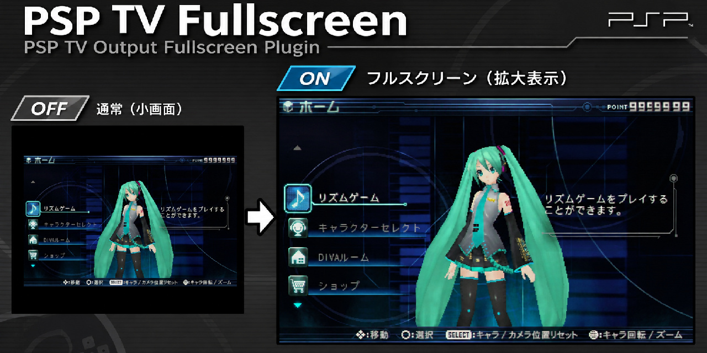

# PSP TV Fullscreen


**v1.0.0** — Native full-width PSP GAME video over 480i and 480p TV-out.

An experimental PSP-3000 kernel plugin that selects Sony's built-in TV scaling presets to make PSP games fill the available TV-out picture instead of retaining the stock 480×272-centered game window. The plugin does not render new pixels, patch games, or implement its own deinterlacer.

[日本語の説明 / Japanese documentation](README_JA.md)

## Verified configuration

- **Hardware:** PSP-3000 (04g)
- **Firmware:** 6.61 with ARK-5
- **Plugin runlevel:** `game` only; not VSH and not POPS
- **Video:** component TV-out, both 480i and 480p
- **Aspect settings:** 16:9 and 4:3
- **Hardware testing:** all four combinations passed on November 7, 2026, including game operation and HOME transitions (one hardware configuration).

| TV setting | Sony scaler preset | Nominal scaled image | Nominal horizontal offset |
| --- | ---: | ---: | ---: |
| 480i / 16:9 | 5 | 698×480 | 11 |
| 480i / 4:3 | 1 | 698×360 | 11 |
| 480p / 16:9 | 5 | 698×480 | 11 |
| 480p / 4:3 | 1 | 698×360 | 11 |

The 480i hardware timing remains **720×479 active lines** in the observed GAME mode. `698×480` is the scaling preset's nominal image geometry, not a claim that its 480i timing has been changed to 480 progressive lines. The scaler leaves 11 horizontal pixels on either side of the 720-pixel region.

**Compatibility beyond the exact configuration above has not been tested.** This is not a POPS/PS1 plugin. It does not provide nearest-neighbor scaling; Sony's native filtering is retained.

## How to build (Ubuntu / WSL)

An existing, configured [PSPSDK / PSPDEV](https://github.com/pspdev/pspdev) toolchain is required.

```bash
make clean && make
# or:
./build_psp.sh
```

The generated plugin is `PSPTVFullscreen.prx`. The repository contains source, not a precompiled PRX; the maintainer can attach their **hardware-tested PRX** to a GitHub release separately.

## Install on the PSP (ARK-5)

1. Back up any working previous `PSPTVFullscreen.prx`.
2. Copy the newly built `PSPTVFullscreen.prx` to `ms0:/SEPLUGINS/`.
3. Enable it **only in GAME** using ARK's plugin manager, or put the following entry in `ms0:/SEPLUGINS/PLUGINS.TXT`:

   ```text
   game, ms0:/SEPLUGINS/PSPTVFullscreen.prx, on
   ```

4. Disable older fullscreen PRX versions and any testing probes that target the same LCDC setup. Fully power down and restart the PSP.
5. Choose 480i or 480p and 16:9 or 4:3 in PSP TV settings; test with a game and the HOME menu.

The ARK-5 source uses `ms0:/SEPLUGINS/PLUGINS.TXT` and the `game` runlevel. Refer to [ARK-5 plugin handling](https://github.com/PSP-Arkfive/ARK-5/blob/main/XMBControl/src/plugins.c) for details. If the existing plugin manager already controls this plugin, do not add a duplicate entry.

## GBS-Control: observed 480i issue

**This is an external scaler issue observed on the test setup, not a universal requirement of the PSP plugin.** The GBS-Control device displayed both unmodified PSP 480i and the plugin's 480i as horizontally wrapped/split when its internal deinterlacer registers were in a Motion Adaptive state. Explicitly selecting **BOB** made both display normally; the verified BOB command on that test setup was:

```text
http://gbscontrol.local/uc?q
```

Observed split state: `s2_00=0x19`, `s2_16=0x00`; normal BOB state: `s2_00=0xFF`, `s2_16=0x80`. These observations do **not** prove the underlying GBS-Control firmware defect or implicate PSP's scaling as the cause. Other displays/scalers are untested.

## Technical design

- 480i: select Sony's native preset in the initial XMB-to-GAME window; allow firmware to perform the transition to GAME mode (`0x6D1`) by itself. **Never force an LCDC SetMode/refresh for interlaced TV-out.**
- 480p: preserve the previously verified native refresh path for GAME mode (`0x2D2`).
- Read only display/MMIO state to classify the known hardware modes. No custom MMIO writes, GE hooks, game patches, or continuous in-game monitor.
- If aspect settings or video mode are not recognized, avoid risky changes.
- At startup, diagnostics are written to `ms0:/PSPTVFullscreen_probe.csv` once (overwrites the previous file). This behavior is intentionally retained in v1.0.0 so that the released source matches the exact RC7 code tested on real hardware.

## Verify and recover

Host-only state-flow checks:

```bash
./tests/run_host_tests.sh
```

The six host tests are **not** substitutes for running the PRX on PSP hardware. If anything behaves incorrectly, disable this GAME plugin and restore the backed-up previous PRX. For 480i issues with GBS-Control, confirm BOB/MA state before changing PSP video code.

## Version and distribution

`v1.0.0` is the frozen publication of the **unchanged v1.0.0-rc7 implementation** that passed four-mode testing. The RC7 identifier in `main.c` and the worker thread name is intentionally retained to preserve tested-source identity; no runtime changes were introduced during GitHub packaging.

See [CHANGELOG.md](CHANGELOG.md) and [RELEASE_NOTES.md](RELEASE_NOTES.md). The project has **no redistribution license selected yet**; publishing the source does not grant a general license to redistribute modified versions. Choose an appropriate license before inviting third-party reuse.
