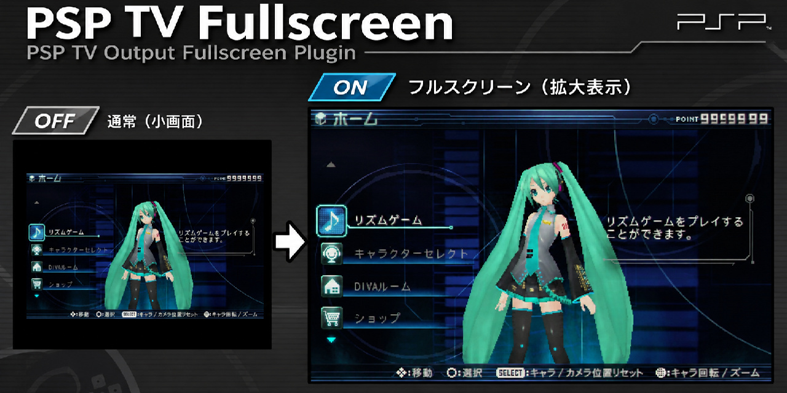

# PSP TV Fullscreen — v1.0.0



PSP-3000の**ゲーム用TV出力をSony純正の拡大プリセットでフル幅表示**する、ARK-5向けGAME専用PRXプラグイン。

480iと480pの両方に対応する。ゲーム自体の描画解像度を変更するものではなく、PSP内蔵LCDCスケーラを利用する。補間をNearestに置換する機能はない。

## 実機検証済み環境（2026-11-07）

- PSP-3000（04g）、FW 6.61、ARK-5
- コンポーネントTV出力の480i／480p
- TVタイプ16:9／4:3の**全4構成で正常表示を確認**
- ゲーム操作、HOME画面との往復も確認
- ほかのPSP型番／FW／出力機器は未検証

| TV出力 | テレビタイプ | Sonyプリセット | 映像領域 | LCDC水平位置 |
| --- | --- | ---: | ---: | ---: |
| 480i | 16:9 | 5 | 698×480 | X=11 |
| 480i | 4:3 | 1 | 698×360 | X=11 |
| 480p | 16:9 | 5 | 698×480 | X=11 |
| 480p | 4:3 | 1 | 698×360 | X=11 |

480iの**実際の出力タイミングは720×479ライン**であり、上表の「698×480」はSony拡大プリセット上の画面サイズ。480iを480pに変換したという意味ではない。横の余白は左右11pxずつ。4:3では縦方向に黒帯が入る。

## インストール（ARK-5）

1. 運用中の正常な `PSPTVFullscreen.prx` があればバックアップ。
2. 新しいPRXを `ms0:/SEPLUGINS/PSPTVFullscreen.prx` に配置。
3. ARK-5のプラグインマネージャーで **GAMEだけON** にする。`PLUGINS.TXT` で指定する場合は次の1行。

   ```text
   game, ms0:/SEPLUGINS/PSPTVFullscreen.prx, on
   ```

4. 同系統の古いフルスクリーンPRXとTiming Probeを無効化。重複登録もしない。
5. PSPを完全に電源OFFして再起動。480i／480pと16:9／4:3を切り替えて、ゲーム画面とHOME往復を確認。

ARK-5の設定例は[公式実装のプラグイン処理](https://github.com/PSP-Arkfive/ARK-5/blob/main/XMBControl/src/plugins.c)と整合する。既にプラグインマネージャーで登録済みなら同じエントリーを追加しないこと。

## Ubuntu / WSLからのビルド

PSPSDK（`psp-gcc`、`psp-config`）が設定済みの環境で実行する。

```bash
make clean && make
# または
./build_psp.sh
```

出力は `PSPTVFullscreen.prx`。**本リポジトリはソース配布用**。実機で試したPRXバイナリをGitHub Releasesの添付ファイルとして配布するなら、作成者が手元のPRXをアップロードする必要がある。

## GBS-Controlの480iに関する注意

検証に使用したGBS-Controlでは、MA（Motion Adaptive）相当のレジスタ状態でPSPの480iが**左右に分裂**する現象があった。PRXをすべてOFFにしても再現したため、フルスクリーンPRX固有の不具合とは認められなかった。

GBS-ControlのBOBを明示的にONにすると正常表示へ復帰した。検証したコマンドは次の通り。

```text
http://gbscontrol.local/uc?q
```

異常時の `s2_00=0x19 / s2_16=0x00` に対し、正常時のBOB用設定は `s2_00=0xFF / s2_16=0x80`。**GBSのMA状態が主因と考えられるものの、原因コードまで確定したわけではない。** すべてのGBSや他のアップスケーラで同じ問題が起きるとは限らない。

## 技術的な制御

- **480i：** XMBからゲームへ切り替わる直前にSony純正プリセット5/1を一度選択。ゲーム用LCDCモード `0x6D1`、有効479ラインへの移行は純正処理に任せる。**480iでは強制 `sceLcdcSetMode` 相当の更新を行わない。**
- **480p：** 既存RC1系で成功済みのモード `0x2D2` 判定と純正再設定処理を維持。
- **安全側動作：** 未知のモードやテレビ設定の取得失敗時は適用しない。MMIOは読み取りのみ。ゲーム描画・GEをフックしない。
- **診断CSV：** 起動時に `ms0:/PSPTVFullscreen_probe.csv` を上書き生成。これはRC7と**同じソースを正式凍結するため意図的に残している**。不要だからと削るとPRXが変わり、再度実機検証が必要になる。

## テスト・復旧

ホスト側の状態遷移テスト（6ケース）：

```bash
./tests/run_host_tests.sh
```

このテストはPRXのPSP実機動作を保証しない。映像が異常ならGAMEプラグインをOFFにして、退避したPRXへ戻す。GBSを使う場合はBOB/MA状態も確認する。

## 凍結版について

**`v1.0.0` = 全モード実機検証に通ったRC7のソースを機能変更せず公開した版。** `main.c`先頭のRC7表記、スレッド名 `PSPTVFullRC7` は検証済みコードとの一致を優先して残している。GitHub向けに変更したのは説明文や自動テスト設定だけ。

現時点では**再配布ライセンスを指定していない**。第三者による改変・再配布を認める場合は、公開時にLICENSEを選択すること。
